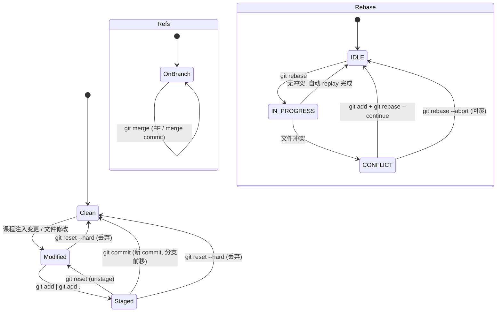

# GitGood 状态机：合法迁移与回滚路径

GitGood 的虚拟仓库由五类状态构成一张状态图：

| 状态 | 数据 | 位置 |
|------|------|------|
| 工作区 (W) | `working_changes` | `RepositoryState` |
| 暂存区 (I) | `staged_changes` | `RepositoryState` |
| 提交对象库 (O) | `commits: sha -> Commit` | `RepositoryState` |
| 引用 (R) | `branches` / `remote_branches` / `head` | `RepositoryState` |
| rebase 状态 (RB) | `IDLE / IN_PROGRESS / CONFLICT` + 回滚锚点 | `RepositoryState.rebase` |

## 合法迁移

## 迁移规则（前置条件）

- `git add`：文件从 W 移到 I；重复 add 幂等（同一文件在 I 中唯一）。
- `git commit`：仅当 I 非空；把 I 固化为新 commit 加入 O，当前分支引用前移，I 清空。
- `git checkout <b>`：仅当 `<b>` 存在且 rebase 空闲；失败时不改变任何状态（原子）。
- `git merge <b>`：仅当 `<b>` 存在且 rebase 空闲；祖先关系决定 FF / merge commit / Already up to date；失败时不改变任何状态。
- `git rebase <u>`：仅当工作区/暂存区干净、rebase 空闲；冲突时进入 CONFLICT 并记录回滚锚点（原分支名 + 原 sha）。
- CONFLICT 中禁止：`checkout` / `merge` / `commit` / 嵌套 `rebase`；允许：`add`、`rebase --continue`、`rebase --abort`、只读命令。
- `gh pr merge`：目标分支存在且合并成功才将 PR 置为 MERGED；任何一步失败 PR 保持 OPEN，仓库状态不变。

## 回滚路径

| 异常 | 回滚 | 结果 |
|------|------|------|
| rebase 冲突 | `git rebase --abort` | 分支引用恢复 `original_sha`，清理冲突暂存项，RB→IDLE |
| rebase 冲突（继续） | `git add` + `git rebase --continue` | replay 剩余提交，RB→IDLE |
| checkout 不存在分支 | 无操作（原子失败） | head/branches/W/I 全部不变 |
| merge 不存在分支 | 无操作（原子失败） | O/R 不变 |
| gh pr merge 失败 | 无操作（原子失败） | PR 保持 OPEN，仓库不变 |
| 误暂存 | `git reset <file>` / `git reset` | I→W 或 I 清空 |
| 未捕获异常 | 执行器自动 `restore_consistency()` | 见下方不变量 |

## 状态不变量（异常后总能恢复的一致状态）

`VirtualRepository.check_invariants()` 校验、`restore_consistency()` 修复：

- **INV-1 引用闭合**：`head ∈ branches`；每个本地/远程分支的 `commit_sha ∈ commits`。
- **INV-2 对象闭合**：每个 commit 的 `parent_sha` / `merge_parent_sha` 为 `None` 或存在于 `commits`。
- **INV-3 索引一致**：`staged_changes` 与 `working_changes` 各自文件名唯一（无重复项）。
- **INV-4 PR 引用**：OPEN 状态的 PR 其 source/target 分支必须存在（修复：自动 CLOSE 失效 PR）。
- **INV-5 rebase 锚点**：RB ≠ IDLE 时，`original_branch ∈ branches` 且 `original_sha ∈ commits`（修复：尽力回滚到锚点后清空 rebase 状态）。

保证：每条命令执行后（包括抛出未捕获异常时）执行器都会校验上述不变量，
违反时调用 `restore_consistency()` 修复，因此任何异常序列之后仓库都能回到一致状态。
